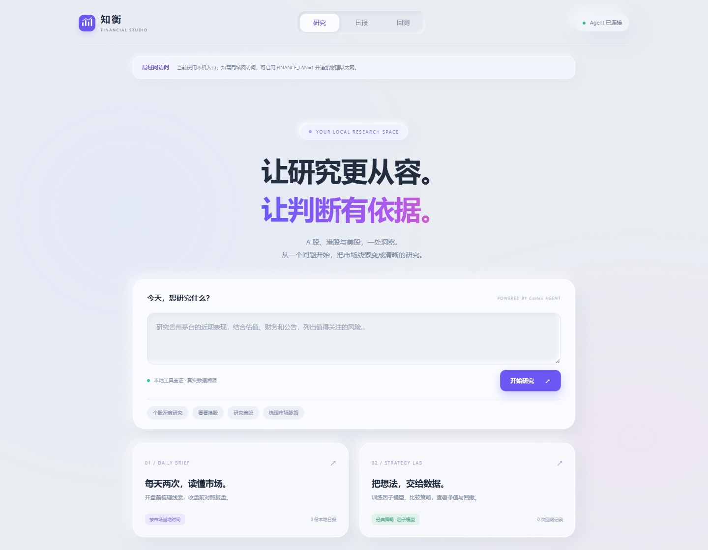

<p align="center">
  
</p>
<h1 align="center">知衡 · Financial Agent</h1>
<p align="center">让研究更从容，让判断有依据。</p>
<p align="center">面向 Codex 的本地金融研究插件 · A 股 / 港股 / 美股</p>
<p align="center">
  <a href="#功能特色">功能特色</a> · <a href="#插件安装">插件安装</a> · <a href="#快速使用">快速使用</a> · <a href="#问题解决">问题解决</a> · <a href="docs/README.md">完整文档</a>
</p>

## 功能特色

| 能力 | 你可以做什么 |
| --- | --- |
| **三市场研究** | 查询 A 股、港股与美股行情、财务、估值及可得公告，结合来源与数据时点展开分析 |
| **双时点日报** | 开盘前梳理市场，收盘前对照复盘；支持手动报告、历史归档和图表阅读 |
| **持仓工作台** | 独立页面管理持仓、查看仓内行情、分析仓位，回测与部署当前持仓股票池 |
| **策略实验室** | 比较 8 种经典策略，训练 XGBoost / Elastic Net，查看净值、回撤与交易记录；[策略解读](http://127.0.0.1:3205/strategy-guide)说明每种策略的适用情形 |
| **模拟交易** | 从当前持仓复制初始仓位，选择策略持续模拟，跟踪累计收益、模拟持仓和成交 |
| **本地工作台** | 复用 Codex 登录，插件加载时自动启动网页；研究数据保存在本机 |



<sub>当前版本界面，截图使用空任务、空归档状态。</sub>

## 插件安装

支持 **Windows 与 Ubuntu**，准备 **Node.js ≥ 22.13、npm 和本地 uv**。uv 自动准备 Python 3.12，无需手动安装 Python 或激活虚拟环境。

下载或克隆仓库后，在根目录选择安装入口：

| 安装方式 | 命令 | 后续操作 |
| --- | --- | --- |
| Codex CLI | `npm run install:cli` | 自动注册 marketplace 并安装，新建聊天启用插件 |
| Codex App | `npm run install:app` | 将输出目录作为项目打开，在插件列表选择“知衡本地插件”并点击安装 |

CLI 安装需要支持 `codex plugin add` 的 Codex CLI。App 安装准备不依赖 CLI；网页自然语言研究仍需要已登录的 Codex CLI。Ubuntu 可使用 CLI；App 是否可用以官方客户端支持的平台为准，插件不提供 Linux 桌面客户端。

例如，在 Windows PowerShell 或 Ubuntu 终端中执行相同命令：

```powershell
npm run install:cli
```

安装器会准备依赖并生成干净的分发目录。插件缓存副本首次加载时，在后台通过本地 uv 配置自己的 Python 环境；后续启动直接复用。自定义 uv 路径、镜像与离线配置，以及解压 ZIP 安装方式，见[安装与更新指南](docs/getting-started.md)。

## 快速使用

在 Codex 中直接提出研究需求：

```text
用知衡研究 AAPL，核对行情、财报和 SEC 披露，注明来源与数据时点。
比较我保存的港股持仓，列出证据差异和主要风险。
打开知衡工作台，查看日报和历史回测。
```

网页研究使用已有 Codex 登录。在仓库根目录也可独立启动：

```powershell
codex login
npm start
```

打开[研究工作台](http://127.0.0.1:3205)、[日报](http://127.0.0.1:3205/reports)、[我的持仓](http://127.0.0.1:3205/portfolio)或[策略实验室](http://127.0.0.1:3205/backtests)。端口占用时，以启动输出或插件返回的地址为准。

持仓页按市场读取已保存股票，支持行情刷新、持仓分析和持仓池回测／部署。策略任务启动时固定持仓名单，结果保留该次名单与时间；仅以代码构建股票池，不还原实际持股数量或历史仓位。持仓池记录与自定义股票池分别归档，原策略实验室继续用于自定义回测和模型训练。

[模拟交易](http://127.0.0.1:3205/simulation)：默认复制当前持仓股数，按完整日线信号调仓，持续更新累计收益与模拟仓位；开始或恢复前可选择允许新股入仓，并设置本次新增资金（默认 0）。追加资金记为本金，不记作收益。可选择“AI 模拟”，由 Codex 逐股分析持仓并从可用日线策略中推荐一个，依据单独显示。暂停后可切换策略并保留账本，再恢复运行。停止则删除该次记录。服务断开后自动暂停，重启后手动恢复；仅关闭页面时服务仍会继续。启动工作台时自动识别本机以太网 IPv4，局域网地址显示在页面中；设置 `FINANCE_LAN=0` 可关闭局域网访问。首页研究记录可直接删除。

## 问题解决

| 问题 | 处理方式 |
| --- | --- |
| 日报打不开 | 请 Codex“打开知衡工作台”获取实际地址，或在运行目录执行 `npm start`；见[服务启动排查](docs/troubleshooting.md#日报或工作台打不开) |
| Python 依赖缺失 | 在实际安装目录运行 `npm run setup`，见[运行环境](docs/getting-started.md#准备运行环境) |
| 网页研究失败 | 确认 `codex login` 已完成，查看网页任务错误，见[研究失败排查](docs/troubleshooting.md#网页研究或日报复核失败) |
| MCP 启动报错 | 检查 Node 路径与插件路径展开，见[MCP 排查](docs/troubleshooting.md#mcp-无法启动) |

安装、配置、数据口径和开发细节统一收录于[完整文档](docs/README.md)。本项目用于研究，不连接券商、不执行交易。

---

[MIT License](LICENSE) · Copyright © 2026 **Yiwen Pang**
