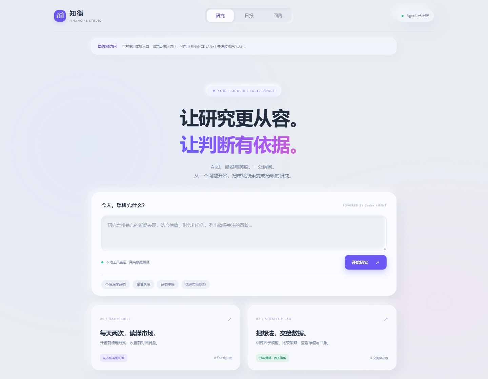

# 网页工作台

[项目首页](../README.md) · [文档导航](README.md)

## 服务生命周期

Codex 加载插件时异步启动本地后台服务，工具发现无需等待网页就绪。网页工具会等待服务启动；失败时返回错误，再次调用会重试。

同一运行目录通过启动锁与 `.runtime/web.json` 复用服务，并核对服务身份。`npm start`、多个 MCP 会话不会重复启动同目录的调度器。自动启动的后台服务在聊天结束后继续运行，可在对应目录使用 `npm stop` 停止。

默认仅监听本机。内部 Python 取数和报告服务使用系统分配的回环端口，由工作台进程管理。启动诊断写入 `.runtime/workspace.log`；状态和缓存不应提交到 Git。

## 页面与任务

| 路由 | 用途 |
| --- | --- |
| `/` | 输入自然语言研究问题、查看任务进度与结果 |
| `/reports` | 按市场查看日报归档、手动生成报告、管理与复核持仓、策略部署 |
| `/backtests` | 选择市场、周期、股票池和策略，训练模型或查看回测记录 |

网页研究与日报复核使用已登录的 Codex CLI，默认模型为 `gpt-6-sol`，可通过 `FINANCE_CODEX_MODEL` 覆盖。研究结果记录实际模型、会话和调用工具；任务支持取消，服务重启后先前运行中的任务会标记为中断。



## 日报与策略

日报先由数据引擎查证并保存快照，再经 Codex 复核；完成后原子写入归档并通知页面。非交易日跳过，复核失败不发布半成品。手动报告与上午/下午的定时报告独立归档。详见[日报与调度](daily-reports.md)。

策略实验室支持 A 股、港股、美股，周期为日线、周线、月线。A 股训练与回测可选择沪深300、中证500或自定股票池，部署还可选择全盘；港股与美股使用 1–50 只自定股票。模型按市场和周期隔离，回测区间必须晚于训练标签截止日。

训练成功后可在模型列表查看版本、训练区间与验证结果，再选择版本回测。未通过验证或缺失验证基线的模型可研究回测，不能用于部署。删除模型不会删除历史回测；进行中的策略任务结束后才能删除模型。信号、费用与模拟限制见[工具与市场](tools-and-markets.md#策略与回测口径)。

## 持仓管理

日报页的“管理持仓”支持混合市场文本输入，例如：

```text
600519 100股
港股 00700 300股
美股 AAPL 1.5股
```

输入当前总股数，不按手填写。先预览识别结果，再保存；同市场同代码更新为本次总数，未提及的持仓、原成本和备注保留。代码重复、数量与原文不符或信息不明确时，整批停止，不保存部分结果。

已保存列表可直接编辑股数或删除，不需要模型参与。保存或编辑后，需重新点击“分析我的持仓”取得新结果。持仓复核比较个股研究、所选策略排序及综合结果；配置数值以假设研究预算为分母，不生成交易数量。

持仓保存于 `data/portfolio.json`。按需持仓分析不写入定时日报，也不广播到其他页面。

## 数据与局域网

| 路径 | 内容 |
| --- | --- |
| `data/reports/` | Markdown 日报 |
| `data/report-snapshots/` | 日报结构化快照 |
| `data/web/` | 任务与调度记录 |
| `data/bar-models/` | 按市场、周期隔离的模型 |
| `data/factor-lab/` | 原盘中引擎数据、模型与回测 |
| `config/` | 本地设置 |
| `.runtime/` | 启动状态与日志 |

设置 `FINANCE_LAN=1` 后，工作台识别已连接的物理以太网 IPv4，排除 VPN、虚拟网卡、无线网卡及自动分配地址；网页显示选定网卡和实际端口。没有符合条件的网卡时保留本机访问。

局域网访问仍校验 Host、实际端口及写请求 Origin。其他设备需要与本机处于同一网络，并由本机防火墙允许对应 Node.js 入站连接。内部 Python 服务继续只监听本机。

[安装与配置](getting-started.md) · [历史宿主说明](archive/dsh-workspace.md)
